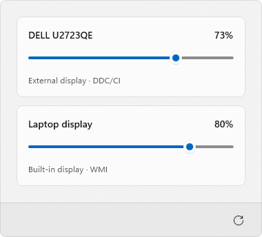
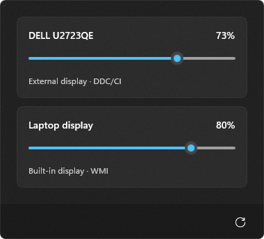

# BrightnessTray

A small Windows 11 tray app for controlling each display's hardware brightness.
Built with C# and WinUI 3, independently of PowerToys.

| Light | Dark |
| --- | --- |
|  |  |

- External displays via DDC/CI; built-in displays via WMI.
- System theme, acrylic with subtle grain and an 80 ms slide animation.
- Click the tray icon to toggle the panel; click outside to dismiss it.
- Unavailable displays are hidden; refresh to rediscover them.
- Scroll over the tray icon to adjust all available displays by 5 percentage
  points per notch, keeping each display within 0–100%.
- Scroll over a brightness slider to adjust just that display by 5 percentage points.
- Hover over the tray icon to see display names and brightness in its native
  tooltip; values update as you scroll.
- Optional **Start with Windows** in the tray menu, disabled by default.

## Build and run

Requires Windows 11 x64, .NET 10 SDK and PowerShell 7.
In Visual Studio, open `BrightnessTray.slnx`, select `Debug | x64` or
`Release | x64`, and set `BrightnessTray.App` as the startup project.

```powershell
pwsh -File .\scripts\build.ps1
pwsh -File .\scripts\publish.ps1
.\artifacts\publish\win-x64\BrightnessTray.exe
```

The publish folder is portable; copy it in full. Enable DDC/CI in your monitor's
menu if needed. Some monitors, drivers and adapters do not support brightness control.

## MSIX

Requires Windows SDK tools and PowerShell 7.5 or newer.

```powershell
pwsh -File .\scripts\package-msix.ps1
```

Outputs a self-contained MSIX and public development certificate in `artifacts/msix`.
Only required Windows App SDK components are included; the .NET runtime is bundled.
For local installation, trust the certificate in **Local Computer → Trusted People**.
The script does not install the package or certificate. Distribution requires your own
trusted signing certificate or Microsoft Store signing.

For a smaller Store build, run `pwsh -File .\scripts\package-store.ps1`.
It creates an unsigned preview in `artifacts/msix/store`, with a shared Windows App
Runtime dependency and bundled .NET. Before submission, rebuild with `-PackageName`
and `-Publisher` matching Partner Center. The interface is the same in both builds.

## Tests

`build.ps1` runs regression and packaging checks. Run `pwsh -File .\scripts\test-ui.ps1`
for UI checks and screenshots with virtual displays; it does not change hardware brightness.
Add `-NativeCapture` to check desktop transparency and shadows on an unobstructed desktop.
Use `-SharedRuntime` to test with an already installed Windows App Runtime 2.5.1+.
All test code lives in `tests/`. The screenshots above use a solid backdrop for capture;
actual acrylic depends on the desktop and Windows transparency settings.
